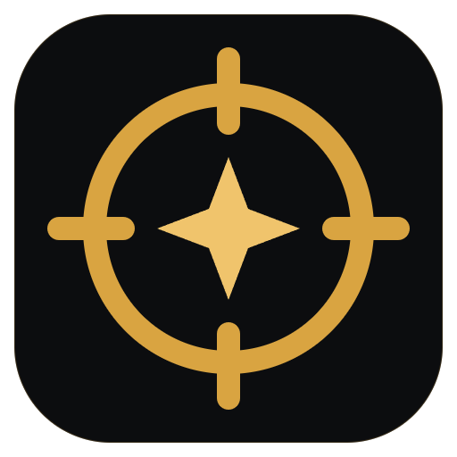

<p align="center">
  
</p>

<h1 align="center">Achievement Hunter</h1>

<p align="center">
  <b>You're 7 achievements away from 100%. Let's go get them.</b><br>
  Paste your Steam profile link and see exactly what's missing in every game, plus how to unlock it.
</p>

<p align="center">
  <a href="https://github.com/YoungRedfox/achievement-hunter-releases/releases/latest"><b>Download for Windows</b></a>
  &nbsp;·&nbsp; Free &nbsp;·&nbsp; Open source &nbsp;·&nbsp; No Steam login
</p>

---

You know the feeling. Hollow Knight sits at 89%, there's one achievement nobody explains properly, and you've got six wiki tabs open. Achievement Hunter puts all of that in one place.

**Paste a link, nothing else.** No Steam login, no password, no API key to hunt for. The app reads your public profile and lays out your whole library.

**See what's left, easiest first.** Every missing achievement is sorted by how many players already have it, so you knock out the easy ones before the 0.8% monsters.

**Get the actual steps.** Hit *How to get it* and you get a short, numbered walkthrough built from real guides, with a warning if it's missable, an estimate of how long it takes, and links to Steam guides and YouTube when you want more.

**Pick the game yourself.** Nothing scans your 400-game backlog behind your back. Open the game you care about; everything you load is saved on your PC and only refreshed when you've actually played since.

**Speaks your language.** English, Polski, Deutsch, Français, Español, Português (Brasil), Русский, 简体中文, 日本語 and 한국어. Achievement names and guides follow the language you pick.

**Updates itself.** When a new version is out, you get one button: download and update.

## Your data stays yours

Your profile, keys and saved data live on your computer, encrypted by Windows. We never upload them.

Our small server does two jobs: it passes public Steam requests along (your public SteamID) and writes guides from a game and achievement number. No accounts, no logs, nothing about you is stored.

Want zero middlemen? Drop your own Steam Web API key or AI key (Gemini or OpenAI) into Settings and the app talks to them directly.

The one requirement: your Steam profile and *Game details* need to be public.

## Build it yourself

```bash
npm install
npm run demo      # the full UI with sample data
npm run dev       # with your real Steam library
npm test
npm run dist      # Windows installer in release/
```

| Folder | What's inside |
|---|---|
| `electron/` | main process: Steam client, encrypted storage, updates |
| `src/` | the React UI and translations (`src/locales/`) |
| `shared/` | types and the guide generator shared with the server |
| `server/` | Cloudflare Worker holding the Steam and AI keys |

Running your own fork? Point `DEFAULT_PROXY_URL` in `shared/config.ts` at your own server.

Security notes for the curious: sandboxed renderer, strict CSP, no DevTools in releases, Electron fuses locked down (no RunAsNode, ASAR integrity checks), and a server that only accepts a short allow-list of Steam endpoints with per-IP rate limits. Releases are built on GitHub Actions; see [CODE_SIGNING_POLICY.md](CODE_SIGNING_POLICY.md).

## Legal

[Privacy policy](PRIVACY.md) · [Terms of use](TERMS.md) · [Third-party notices](THIRD_PARTY_NOTICES.md) · [Steam Web API terms](https://steamcommunity.com/dev/apiterms)

## License

[GPL-3.0](LICENSE) © 2026 YoungRedfox. Use it, learn from it, change it. If you ship a modified version, keep it open source too.

The Achievement Hunter name and logo aren't part of the code license, see [TRADEMARK.md](TRADEMARK.md).

Steam and the Steam logo are trademarks of Valve Corporation. Achievement Hunter isn't affiliated with or endorsed by Valve.
